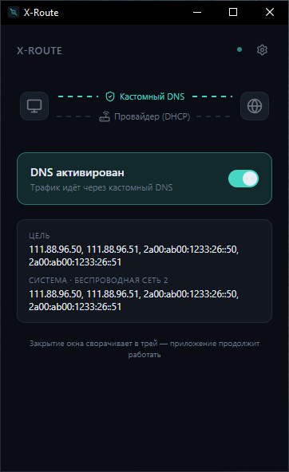

# X-Route

Переключение DNS в Windows одной кнопкой.

## Что это такое

DNS — это то, что переводит адреса сайтов типа google.com в понятные компьютеру числа. От того, какой DNS-сервер использует ваш компьютер, зависит, как быстро открываются сайты и какие сайты доступны.

Многие меняют DNS-серверы, чтобы интернет работал быстрее или чтобы открывались отдельные сервисы. Обычно для этого нужно каждый раз лезть в настройки сети Windows — неудобно и легко запутаться.

X-Route делает это одной кнопкой. Нажали — компьютер использует выбранные DNS-серверы. Нажали ещё раз — Windows снова получает настройки автоматически, как раньше. Ничего вручную менять не нужно.

## Скачать

**[Скачать последнюю версию с GitHub Releases](https://github.com/boevDev/x-route/releases/latest)**

Скачайте `.exe` или `.msi` файл из последнего релиза. Обычно нужен файл вида `X-Route_0.3.0_x64-setup.exe`.

## Как пользоваться

1. Откройте скачанный установщик. Если Windows спросит разрешение на внесение изменений — нажмите «Да»: программе нужны права администратора, чтобы менять сетевые настройки.
2. Пройдите установку: «Далее» → «Установить» → «Готово».
3. Запустите X-Route из меню «Пуск».
4. Нажмите большую кнопку-переключатель в центре окна. Во время переключения будет видно, на каком шаге находится процесс. Готово — DNS подключён.
5. Чтобы вернуть всё как было, просто нажмите переключатель ещё раз — Windows вернётся к автоматическим настройкам.

Свои DNS-адреса можно указать в настройках (кнопка с шестерёнкой в правом верхнем углу). Они сохранятся между запусками — каждый раз вводить заново не придётся.

## Полезно знать

- Закрытие окна не выключает программу — она сворачивается в трей (значок рядом с часами). Клик по значку снова открывает окно, а через правый клик можно выйти совсем.
- Программа сама добавляет себя в автозагрузку и стартует свёрнутой в трей вместе с Windows.
- Если запустить вторую копию — ничего страшного, просто откроется окно уже работающей.

## Если Windows показывает предупреждение

При первом запуске Windows SmartScreen может показать синее окно **«Windows защитила ваш компьютер»**.

Это нормально для небольших бесплатных программ без платной подписи — система просто не знает приложение. Нажмите **«Подробнее»**, затем **«Выполнить в любом случае»**.

## Требования

- Компьютер с Windows.
- Права администратора — программа запросит их сама при запуске, отдельно ничего настраивать не нужно.
